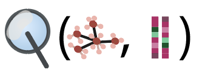

# Focal: focusing gene regulatory networks onto the regulators of cell fate

[Documentation](https://focal-gifs.readthedocs.io/) | [Notebooks](https://github.com/jishnu-lab/FOCAL_notebooks) | [Cite](#citation)

<p align="center">
  <a href="https://focal-gifs.readthedocs.io/"></a>
</p>

Gene regulatory networks inferred from single-cell data are dense: thousands of transcription factor–target links, most of which have little to do with the decision a cell is making. Focal (Factor-Outcome Coupling for Assessment of Linkages) narrows these networks down to the regulators that matter for a given fate decision. It does this by coupling mechanistic network models with interpretable machine learning, so that every prioritised link can be traced back to both a regulatory mechanism and a measurable difference between cell states. We call the result GIFs: GRNs coupled with Interpretable Factor-outcomes.

Focal works on single-cell RNA and ATAC data (sc/snRNA-seq and scATAC-seq), whether the two were measured in the same cells or in separate experiments.

## What Focal does

Focal is organised as three modules that can be used on their own or together.

The **state-specific** module learns sparse cellular programs that separate contrasting cell states, places them in state-specific and cross-state networks, and identifies the transcription factors whose regulons are enriched for each program. Those factors can then be perturbed in silico to see how the programs respond.

The **temporal** module follows regulation along a trajectory. It builds one network per sliding window of cells in pseudotime and converts the networks into forces that each transcription factor exerts on its targets. From these it derives transition-window and episodic networks, orders the waves of regulation into phases, and compares the total regulatory force along each fate branch with how fast the cell-state composition is changing. The points where composition slows down mark the attractor states of the branch.

The **cross-prediction** module transfers programs learned from fate-switching perturbations, such as transcription factor knockouts, to unperturbed data, where they stratify uncommitted cells by their predicted fate bias.

## Installation

Focal runs on top of [dictys](https://github.com/pinellolab/dictys) 1.1.0, which is distributed through conda (channel `lingfeiwang`) and not through PyPI. Installing Focal with pip alone therefore gives a package that cannot be imported. Create the conda environment from the companion notebooks repository first, then install Focal into it. Linux (x86-64) is supported.

```bash
git clone --recurse-submodules https://github.com/jishnu-lab/FOCAL Focal
conda env create -f Focal/docs/notebooks/environment.yml   # creates the `fftemporal` environment
conda activate fftemporal
pip install -e Focal --no-deps
```

The `--no-deps` flag stops pip from re-resolving packages that conda has already installed. Focal does not patch dictys: the additional network statistics it needs are included in `focal.backends.dictys`. Optional extras are available as `.[scanpy]`, `.[celloracle]` and `.[sklearn]`.

## Input data

The temporal module needs a prior for which transcription factors can regulate which genes in each window. Where that prior comes from depends on the data you have.

| Data | How the prior is built | Does it change along pseudotime? |
|---|---|---|
| Matched multiome (RNA and ATAC from the same cells) | dictys is run on each window's own reads: peaks, footprints and motifs | Yes |
| Unmatched scRNA-seq and scATAC-seq of the same system | RNA and ATAC cells are paired by optimal transport (a Gromov-Wasserstein coupling solved per sample with moscot). Each window's accessibility is the coupling-weighted sum of ATAC peak counts, followed by a motif scan and peak-to-gene linking | Yes |
| RNA only | A fixed ATAC-derived base network is restricted to the genes expressed in each window | No, only the fitted weights change |

The same handling of matched and unmatched data is planned for the state-specific module. A step-by-step recipe for each route, including file formats and parameters, is in [`references/grn-inputs.md`](.claude/skills/focal/references/grn-inputs.md).

## Tutorials

The analysis notebooks are kept in a companion repository, [FOCAL_notebooks](https://github.com/jishnu-lab/FOCAL_notebooks), which is included here as a git submodule at `docs/notebooks`. If you cloned without `--recurse-submodules`, fetch it with:

```bash
git submodule update --init docs/notebooks
```

| Folder | What it covers |
|---|---|
| `state_specific/` | State-specific and cross-state networks, program enrichment and in-silico perturbation |
| `temporal/` | Trajectories, dynamic networks, transition-window and episodic networks, force waves and phases |
| `cross_prediction/` | Fate-bias stratification with programs transferred from perturbation data |
| `cd8tcells/` | A complete run on unmatched data: CD8 T cells during acute and chronic LCMV infection, from the joint trajectory and its memory and exhaustion branches to the forces and attractor states along each branch |

The submodule is optional. The package installs and the API documentation builds without it.

## Documentation

The user guide, methods, API reference and rendered notebooks are hosted on Read the Docs at [focal-gifs.readthedocs.io](https://focal-gifs.readthedocs.io/). To build the documentation locally:

```bash
git submodule update --init docs/notebooks   # optional
pip install ".[docs]"
sphinx-build -b html docs docs/_build/html
```

Notebooks are rendered from their stored outputs and are never executed during the build, so no data or GPU is required.

## Using Focal with Claude Code

The repository includes a [Claude Code](https://claude.com/claude-code) skill at [`.claude/skills/focal/`](.claude/skills/focal/SKILL.md). It is a recipe for running Focal end to end on a new dataset: choosing the input route, building the per-window networks, computing forces and attractor states for each fate branch, and running episodic network enrichment, with the CD8 T cell analysis as the worked example. Claude Code loads the skill automatically inside a clone of this repository. To use it elsewhere, copy the folder to `~/.claude/skills/focal/`.

## License

Focal is released under the [MIT License](LICENSE).

## Citation

If you use Focal in your work, please cite this repository. A reference will be added here once a publication is available.

## Contact

Questions, bug reports and feature requests are welcome through the [issue tracker](https://github.com/jishnu-lab/FOCAL/issues).
